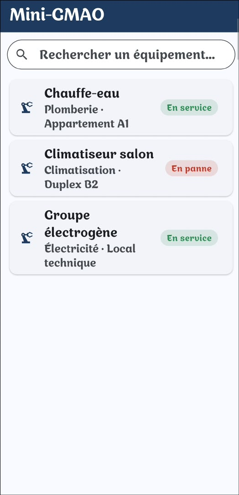
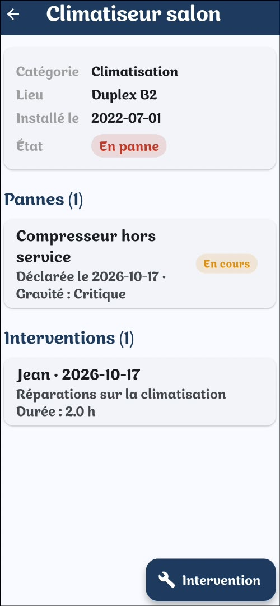
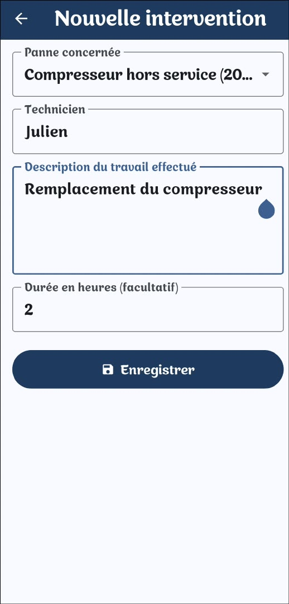

# Mini-GMAO Mobile

Application Android de terrain pour la **GMAO** (gestion de maintenance assistée par ordinateur) : elle permet de consulter les équipements et de saisir une intervention depuis un téléphone.

Elle se connecte à l'API du projet [mini-gmao](https://github.com/Ornella-bit/mini-gmao), en ligne sur https://ashley.pythonanywhere.com.

## Captures d'écran

<p align="center">
  
  
  
  
</p>

## Fonctionnalités

- Liste des équipements avec leur état (En service, En panne...) en couleur
- Recherche instantanée par nom, catégorie, lieu ou état
- Actualisation de la liste en tirant vers le bas
- Fiche d'un équipement : informations, historique des pannes et des interventions
- Saisie d'une intervention (panne concernée, technicien, description, durée), enregistrée dans la base du mini-GMAO
- Messages d'erreur et bouton « Réessayer » en cas de problème de connexion

## Technologies

- **Flutter / Dart** : un seul code, ici compilé pour Android
- Package `http` pour dialoguer avec l'API
- Back-end : **Flask + SQLite**, API JSON déployée sur PythonAnywhere

## Architecture

```
Application Flutter  ──HTTPS / JSON──▶  API Flask (mini-gmao)  ──▶  SQLite
```

Routes de l'API utilisées :

| Méthode | Route | Rôle |
|---|---|---|
| GET | `/api/equipements` | Liste des équipements |
| GET | `/api/equipements/<id>` | Détail, pannes et interventions |
| POST | `/api/pannes/<id>/interventions` | Enregistrer une intervention |

## Installer l'application

1. Télécharge `app-release.apk` dans la page [Releases](https://github.com/Ornella-bit/mini-gmao-mobile/releases/latest).
2. Ouvre le fichier sur ton téléphone Android.
3. Autorise l'installation d'applications inconnues si Android le demande.

## Lancer le projet en développement

```
git clone https://github.com/Ornella-bit/mini-gmao-mobile.git
cd mini-gmao-mobile
flutter pub get
flutter run
```

Pour construire l'APK : `flutter build apk --release`

## Pistes d'amélioration

- Authentification des techniciens
- Déclaration d'une panne depuis l'application
- Consultation du stock de pièces et choix des pièces utilisées lors d'une intervention
- Mode hors ligne

## Auteure

Ashley, étudiante en informatique industrielle et maintenance (UCAO). Projet réalisé dans le cadre de mon portfolio.
